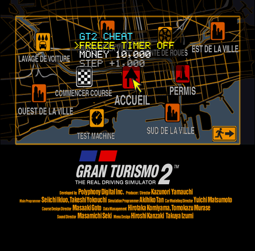
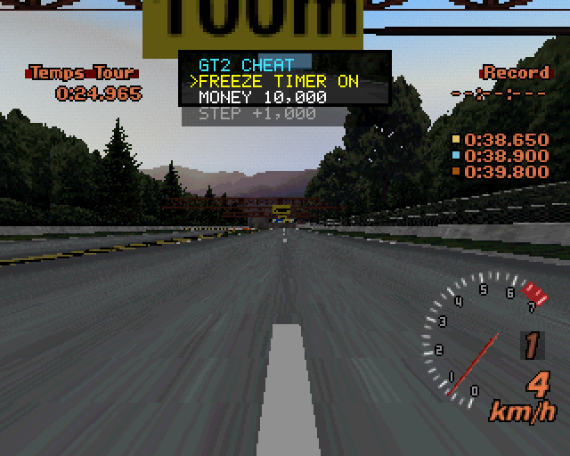

# Gran Turismo 2 (PS1) — overlay cheat menu

🇫🇷 [Version française](README.md)

A patch for **Gran Turismo 2** (PlayStation, European release, Simulation disc **SCES-12380**):
hold **SELECT** and a small menu appears over the game, with two options:

1. **FREEZE TIMER** — stops the clock of the **licence tests**;
2. **MONEY** — changes the credits **live** (adjustable step, maximum, zero).

It works on the original Simulation disc, on the **combined disc**
([GT2-Combined-Disc](https://github.com/CookiePLMonster/GT2-Combined-Disc)) and on pez2k's **GT2
Plus** (beta 7). It only changes `SCES_123.80` and `GT2.OVL`, and this repository holds no game
data. It therefore also applies to a disc already modded elsewhere, for instance the
[MX-5 RF](https://github.com/soaresden/MazdaMx5-nd-rf-ingames) mod by the same author.




## Controls (pad 1)

Two ways to open the `GT2 CHEAT` menu, at the top of the screen:

- **hold SELECT**: the menu appears after a short moment and goes away on release;
- **press L1 + R1 + L2 + R2 together**: the menu opens and **stays open**; **START** (or the four
  shoulder buttons again) closes it. Use this one in **Batocera / RetroArch**, where SELECT is
  the hotkey button: while it is held the game receives nothing, and SELECT + a button triggers
  the emulator's shortcuts.

While the menu is open, the game no longer receives the pad.

| Button | FREEZE TIMER line | MONEY line |
|---|---|---|
| ↑ / ↓ | change line | change line |
| ← / → | ON / OFF | − / + the step (held: repeats) |
| ✕ / ○ | ON / OFF | |
| R1 / L1 | | step × 10 / ÷ 10 (from 1 to 10,000,000) |
| △ | | 99,999,999 (the maximum) |
| □ | | 0 |

- **FREEZE TIMER ON**: in a licence test, the clock stops where it is. If it was already ON at
  the start, it stops at **0:00.040**, right after the start, because a licence test whose clock
  stays at 0 never ends. The choice is kept until the console is switched off.
- **MONEY**: the credits change at once (city map, dealers…).
- A **short** press of SELECT, with no other button, is given back to the game on release.

Tried in PCSX-Redux with the PAL BIOS SCPH-5502:
- on the GT2 Plus combined disc: menu on the language screen, on the city map and in licence
  tests; credits updated on screen (99,999,999); in licence B-1, the clock frozen until the end
  of the test, whether turned on at the start or in the middle of the run;
- on the original combined disc: menu on the city map, credits read at the same address.

Also tried in **RALibretro with the Beetle PSX core** (mednafen), on the GT2 Plus combined disc with
the MX-5 RF: the menu opens with SELECT and with L1 + R1 + L2 + R2. Under Beetle, libpad does not
read the pad again every vertical blank; the cheat skips the reads it has already handled.

## Applying the patch

Python 3, nothing to install:

```bash
python patch_disc.py "Gran Turismo 2.chd"            # -> "Gran Turismo 2 [Cheat].bin" + .cue
python patch_disc.py "Gran Turismo 2.cue" "GT2 cheat.bin"
```

The input can be a `.chd`, a `.cue` or a `.bin` of the Simulation disc, of a combined disc or of
GT2 Plus. Every word changed is checked first: on another game or version, nothing is written.

## How it works

`SCES_123.80` is not compressed. From 0x80010000 to the entry point 0x8005D640 lies the overlay
area (`GT2.OVL`, loaded later); the rest is the resident code, always in memory.

- The **start-up stub** (`src/stub.S`) sits in zeros of the overlay area; the executable's entry
  point points to it. It:
  1. copies the **resident block** (`src/start.S` + `src/cheat.c`, ≈ 2.4 KB) to 0x8000F000, in
     free low RAM, and clears its copy;
  2. calls `cheat_boot`, which changes three places of the resident code after checking that
     they are the expected ones;
  3. flushes the instruction cache and jumps to the game.
- The three places of the resident code, valid in every overlay (menus, races, licences):

| Address | Original | Patch |
|---|---|---|
| 0x8007F97C / 0x8007F980 | address of the pad callback (0x8007F9C0, once per vertical blank) | `pad_hook`: reads port 1, runs the menu, hides the pad from the game, then calls the game's callback |
| 0x8007FF90, 0x80080D04 | `jal 0x800802E0`, drawing a frame's ordering table | `draw_hook`: once the frame is drawn (end of the DMA), draws the menu over it |

- In the **race overlay** (entry 0 of `GT2.OVL`, loaded at 0x80010000), the function 0x8003D154
  adds to the lap clock (0x80046F44, 3,000 per second) and stores it at 0x8003D1C4. The patch
  turns that store into a jump to `tick_store`, which skips it in a licence test (0x801D5896 =
  3) while FREEZE TIMER is on and the clock has left 0. The overlay is compressed again and
  `GT2.OVL` stays within its sectors.
- Credits: 0x801D1598 (u32), the same address in the original game and in GT2 Plus.

Drawing: TILE primitives sent straight to the GPU (GP0), the project's 5×7 font
(`src/font.py`), doubled in 512-wide or 480-line modes, then the game's draw mode is set back.

The findings (addresses, method) are in [NOTES.md](NOTES.md).

## Known limits

- Pad 1 only (with a multitap: its port A).
- While the menu is open, the game no longer sees the pad (in a race, the car goes on with no
  input).
- FREEZE TIMER only acts in licence tests, not in races.
- The clock on screen may move by a few thousandths (the game smooths its display between
  frames); the time counted stays the one it was frozen at.

## Building from the sources

- `src/cheat.c`, `src/start.S`, `src/stub.S`, `src/payload.ld`, `src/font.py`: the code;
- `gt2cheat/game.py`: every game address; `gt2cheat/patcher.py`: the patch;
- `python build.py [--list]`: compiles with a MIPS GCC (`mipsel-none-elf-*` of PSn00bSDK, or
  `mips-linux-gnu-*`) and writes `gt2cheat/payload.py`;
- `tools/emu`: driving PCSX-Redux for the tests, from the GT1 project; `tools/ra.py`:
  disassembly and reference search (capstone).

## Licence

GPL-3.0-or-later. Gran Turismo is a trademark of Sony Interactive Entertainment; fan project, not
affiliated with Sony or Polyphony Digital.
